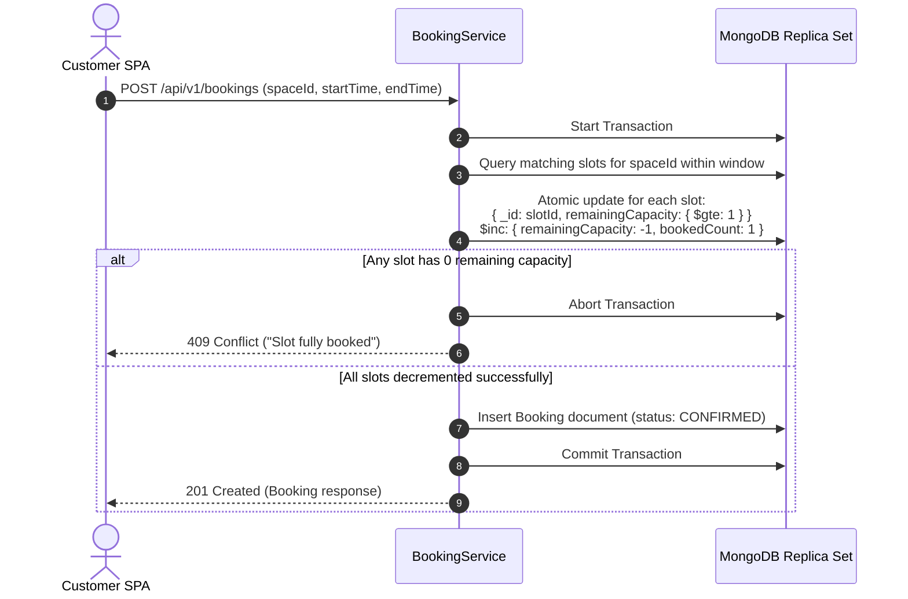

# Phase 3 — MongoDB Schema Design

## 1. Overview and Design Principles

DeskShare uses **MongoDB 8.0** configured with a replica set to enable multi-document transactions. The schema is designed for a modular monolith covering:
- **Users & Authentication** (`users` collection)
- **Coworking Spaces & Inventory** (`spaces` collection)
- **Bookings & Reservations** (`bookings` collection)
- **Availability & Slot Counters** (`availability_slots` collection)

### Key Rules
1. **UTC Everywhere**: All date and timestamp attributes are persisted as UTC ISO-8601 (`Instant` in Java / BSON Date in MongoDB).
2. **Monetary Precision**: Prices and totals are represented in cents or minor units (integer cents, e.g., `1500` = $15.00) or explicit `BigDecimal` with two decimal places.
3. **Atomic Slot Reservation**: To guarantee zero double-bookings under concurrent requests:
   - Capacity is tracked in discrete slot buckets in `availability_slots`.
   - Reservations perform an atomic `findAndModify` / `updateOne` with condition `remainingCapacity > 0` and `$inc: { remainingCapacity: -1, bookedCount: 1 }` within a transaction boundary.
4. **Idempotent Identifiers**: MongoDB `_id` uses standard hex `ObjectId` strings.

---

## 2. Collections and Document Schemas

### 2.1 Collection: `users`

Represents platform users: Customers, Space Owners, and Admins.

```json
{
  "_id": "670c00000000000000000001",
  "email": "customer@example.com",
  "passwordHash": "$2a$12$...",
  "firstName": "Jane",
  "lastName": "Doe",
  "phone": "+1-555-0199",
  "role": "CUSTOMER",
  "active": true,
  "createdAt": "2026-10-13T12:00:00Z",
  "updatedAt": "2026-10-13T12:00:00Z"
}
```

#### Fields
| Field | Type | Required | Description |
|---|---|:---:|---|
| `_id` | String / ObjectId | Yes | Unique User ID |
| `email` | String | Yes | Lowercase, unique user email address |
| `passwordHash` | String | Yes | BCrypt hashed password |
| `firstName` | String | Yes | User first name |
| `lastName` | String | Yes | User last name |
| `phone` | String | No | Contact phone number |
| `role` | String (Enum) | Yes | `CUSTOMER`, `OWNER`, `ADMIN` |
| `active` | Boolean | Yes | Account status flag |
| `createdAt` | Date (UTC) | Yes | Creation timestamp |
| `updatedAt` | Date (UTC) | Yes | Last modification timestamp |

#### Indexes
- Unique index: `{ "email": 1 }`
- Role index: `{ "role": 1 }`

---

### 2.2 Collection: `spaces`

Represents coworking locations, their facilities, pricing, and room types.

```json
{
  "_id": "670c10000000000000000001",
  "ownerId": "670c00000000000000000002",
  "name": "Downtown Innovation Hub",
  "description": "Modern coworking space with ultra-fast fiber internet and panoramic views.",
  "address": {
    "street": "100 Tech Plaza",
    "city": "Austin",
    "state": "TX",
    "postalCode": "78701",
    "country": "USA"
  },
  "location": {
    "type": "Point",
    "coordinates": [-97.7431, 30.2672]
  },
  "type": "HOT_DESK",
  "totalCapacity": 25,
  "priceHourly": 1500,
  "priceDaily": 7500,
  "amenities": ["WIFI", "COFFEE", "PRINTING", "MEETING_ROOM_ACCESS", "PHONE_BOOTH"],
  "imageUrls": ["https://images.deskshare.io/spaces/hub-1.jpg"],
  "active": true,
  "createdAt": "2026-10-13T12:00:00Z",
  "updatedAt": "2026-10-13T12:00:00Z"
}
```

#### Space Types (`SpaceType` enum)
- `HOT_DESK`: Flexible shared workstation.
- `DEDICATED_DESK`: Assigned private desk.
- `PRIVATE_OFFICE`: Lockable private team office.
- `MEETING_ROOM`: Hourly reservable conference or meeting room.

#### Indexes
- Geospatial 2dsphere index: `{ "location": "2dsphere" }`
- Owner compound index: `{ "ownerId": 1, "active": 1 }`
- Search filter index: `{ "type": 1, "active": 1, "priceHourly": 1 }`
- City search index: `{ "address.city": 1, "active": 1 }`

---

### 2.3 Collection: `bookings`

Represents reservations made by customers.

```json
{
  "_id": "670c20000000000000000001",
  "userId": "670c00000000000000000001",
  "spaceId": "670c10000000000000000001",
  "ownerId": "670c00000000000000000002",
  "startTime": "2026-10-14T09:00:00Z",
  "endTime": "2026-10-14T17:00:00Z",
  "slotCount": 1,
  "totalPrice": 7500,
  "currency": "USD",
  "status": "CONFIRMED",
  "notes": "Need quiet area near window",
  "createdAt": "2026-10-13T12:00:00Z",
  "updatedAt": "2026-10-13T12:00:00Z"
}
```

#### Booking Status (`BookingStatus` enum)
- `CONFIRMED`: Active, valid reservation.
- `CANCELLED`: Cancelled by customer or operator; slots returned.
- `COMPLETED`: Booking window completed.

#### Indexes
- Customer history index: `{ "userId": 1, "startTime": -1 }`
- Space reservation index: `{ "spaceId": 1, "startTime": 1, "endTime": 1, "status": 1 }`
- Owner dashboard index: `{ "ownerId": 1, "createdAt": -1 }`

---

### 2.4 Collection: `availability_slots`

Atomic slot allocation inventory per space per date/time slot. This enables atomic decrements and optimistic concurrency control without race conditions.

```json
{
  "_id": "670c30000000000000000001",
  "spaceId": "670c10000000000000000001",
  "slotDate": "2026-10-14",
  "startTime": "2026-10-14T09:00:00Z",
  "endTime": "2026-10-14T10:00:00Z",
  "totalCapacity": 25,
  "remainingCapacity": 24,
  "bookedCount": 1,
  "version": 1
}
```

#### Indexes
- Unique slot index: `{ "spaceId": 1, "startTime": 1 }` (unique)
- Date query index: `{ "spaceId": 1, "slotDate": 1 }`

---

## 3. Transaction Boundaries and Atomic Concurrency

### Double-Booking Prevention Algorithm



### Cancellation & Slot Rollback
When a booking is cancelled:
1. Transaction opened.
2. Booking status updated from `CONFIRMED` to `CANCELLED`.
3. For each slot corresponding to the booking window:
   `$inc: { remainingCapacity: 1, bookedCount: -1 }`.
4. Transaction committed.
